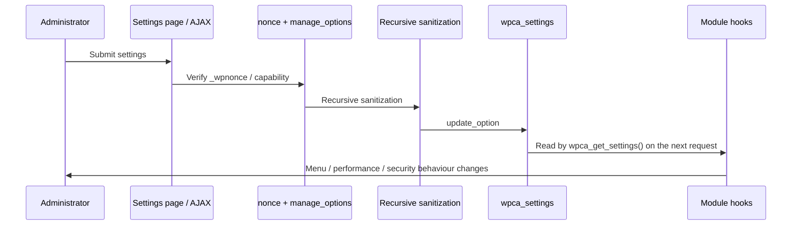

# WP Clean Admin Installation and Deployment Guide (English)

> **Applies to**: 1.9.18  |  **Last updated**: 2026-11-25  |  **Status**: Current document
> Audience: site administrators, operations staff and developers. Read [§1 Environment Requirements](#1-environment-requirements) before installing; feature details live in [`功能模块说明.md`](功能模块说明.md).
> The Simplified Chinese original is [`安装部署指南.md`](安装部署指南.md); when the two diverge, the Chinese original wins.

## Table of Contents

- [1. Environment Requirements](#1-environment-requirements)
- [2. Obtaining the Distribution Package](#2-obtaining-the-distribution-package)
- [3. Standard Installation](#3-standard-installation)
- [4. Post-Installation Configuration](#4-post-installation-configuration)
- [5. Multi-Environment Deployment](#5-multi-environment-deployment)
- [6. Verification Methods](#6-verification-methods)
- [7. Upgrade, Rollback and Uninstall](#7-upgrade-rollback-and-uninstall)
- [8. Document Version Control](#8-document-version-control)

---

## 1. Environment Requirements

| Dependency | Minimum version / condition | Required | Notes and code basis |
|------------|----------------------------|----------|-----------------------|
| WordPress | ≥ 5.0 | Required | Declared in the plugin header; `wpca_is_wp_version_gte()` lives in `includes/wpca-core-util-functions.php` |
| PHP | ≥ 7.4 | Required | Plugin header and `composer.json`; CI includes a PHP 7.4 syntax lint job |
| MySQL | ≥ 5.6 | Required | The plugin reads and writes options and usermeta; `uninstall.php` executes SQL directly |
| PHP GD extension | Any working version | Conditionally required | Required by the login image captcha; without it image generation is skipped safely and login validation rejects requests without a captcha (see `modules/admin/classes/class-wpca-login-captcha.php`) |
| Filesystem write access | `uploads/wpca-cache/` must be writable | Conditionally required | The file cache backend writes JSON files; switch to the memory/database backend if this is unavailable |
| Object cache (Redis/Memcached) | Optional | Optional | Not integrated directly by this plugin; a third-party drop-in can complement it |
| Browser | Modern browser (ES6 capable) | Required | No IE-compatible build is shipped for the settings page and admin bar scripts |

> Dependency facts come from `wp-clean-admin.php`, `composer.json`, `uninstall.php` and the module code. Runtime verification is performed by CI or on a real site.

## 2. Obtaining the Distribution Package

1. Recommended: download `wp-clean-admin.zip` from GitHub Releases (published automatically by `release.yml` once CI is green).
2. Development/testing: check out the `main` branch and run `composer install --no-dev` inside `wpcleanadmin/` (requires a local PHP/Composer setup).
3. Validation: confirm the package contains `wp-clean-admin.php` (`Version: 1.9.18`), `includes/autoload.php`, `includes/modules/` and `uninstall.php`. A package missing any of these is incomplete.

## 3. Standard Installation

### 3.1 Upload from the WordPress admin (recommended)

```text
Admin → Plugins → Add New → Upload Plugin → choose wp-clean-admin.zip → Install Now → Activate
```

1. Back up the site (database and `wp-content/`) before uploading.
2. Activation runs `wp-clean-admin.php:139-190`: it writes the default `wpca_settings` (existing values are preserved) and calls `flush_rewrite_rules()`.
3. Verify that a **Settings** shortcut link appears in the plugin list (`wp-clean-admin.php:218-233`).

### 3.2 Manual FTP installation

1. Extract the archive and upload the `wpcleanadmin/` directory to `wp-content/plugins/` (for example `wp-content/plugins/wp-clean-admin/`).
2. Admin → Plugins → Installed Plugins → activate WP Clean Admin.
3. If the directory is not named `wp-clean-admin` the plugin still runs (constants are derived from `WPCA_PLUGIN_DIR`/`WPCA_PLUGIN_URL`), but language files and update checks may be affected; keeping the standard directory name is recommended.

### 3.3 Deactivation and uninstall

- Deactivate: only `flush_rewrite_rules()` is called, and **all settings are preserved** (`wp-clean-admin.php:194-209`).
- Uninstall: deleting the plugin from the admin triggers `uninstall.php`, which removes the six known options, all `wpca_%` options, `_transient_wpca_%` transients and `wpca_%` usermeta. Since 1.9.18 it also clears WP-Cron events and the file cache directory (`uploads/wpca-cache`). Backup and log directories still need manual cleanup.

## 4. Post-Installation Configuration

### 4.1 Entry point and tabs

Admin → **WP Clean Admin → Settings**. The page contains five tabs: General / Cleanup / Performance / Security / Diagnostics. Containers and buttons carry semantic IDs (`wpca-settings-tabs`, `wpca-tab-general`, and so on) for automation and troubleshooting.

### 4.2 Defaults written on activation (`wp-clean-admin.php:142-169`)

| Group | Key = default value |
|-------|--------------------|
| `general` | `clean_admin_bar=1`, `clean_dashboard=1`, `remove_wp_logo=1` |
| `performance` | `optimize_database=1`, `clean_transients=1`, `disable_emojis=1` |
| `menu` | `remove_dashboard_widgets=1`, `simplify_admin_menu=1` |
| `security` | `hide_wp_version=1`, `disable_xmlrpc=1`, `restrict_rest_api=1`, `restrict_admin_access=1` |
| `diagnostics` | `enable_diagnostics=1`, `auto_run_diagnostics=0`, `show_warnings=1`, `severity_filter='all'` |

> Existing settings are not overwritten by the defaults (`array_merge($default_settings, $current_settings)`). The `user_roles` group has no default keys; it is created in the corresponding module when custom roles are first defined.

### 4.3 Save and activation paths



- Write paths: the settings page uses `register_setting('wp-clean-admin', 'wpca_settings')`; the menu customizer AJAX writes `wpca_menu_customizer_settings`. The three handler methods in `includes/ajax/settings-ajax.php` that were never registered were removed in 1.9.18, leaving only the `sanitize_settings()` compatibility proxy.
- Read path: `wpca_get_settings()` (`includes/wpca-core-settings-functions.php`), with request-level memoization since 1.9.18; write paths invalidate the cache automatically.
- Third-party intervention: `apply_filters('wpca_update_settings', $settings)` (same file).

### 4.4 Recommended minimal configuration

1. Keep the default `general`/`menu` switches and observe the admin appearance first.
2. Turn on performance options one at a time (emoji/heartbeat/database optimization) and verify both the front end and the admin area after each change.
3. Before enabling the security options, note that `restrict_rest_api` makes anonymous REST requests return HTTP 403 (error code `rest_not_logged_in`) while logged-in users are unaffected; 2FA should only be enforced after every user has completed TOTP binding.
4. When the login captcha is required, confirm that the GD extension is available.

## 5. Multi-Environment Deployment

| Environment | Installation method | Configuration differences | Verification focus |
|-------------|---------------------|---------------------------|---------------------|
| Local development | Source checkout + `composer install`; symlink or copy the plugin directory into `wp-content/plugins/` | `WP_DEBUG=true`; use the file/memory cache backend; disable enforced 2FA to ease debugging | No plugin exceptions in `wpca_init()`; all five tabs visible; AJAX nonce valid |
| Staging | Same-version Release zip as production | Copy production configuration with sensitive data redacted; enable diagnostics `show_warnings` | Same PHP/WP version as production; cache/database cleanup does not delete anything unintended |
| Production (single site) | Release zip uploaded through the admin | Enable only verified switches; `WP_DEBUG=false` | First-screen performance, login flow, REST/captcha behaviour, backup restore drill |
| Production (multisite) | Network activation or per-site activation | `Helpers::is_network_activated()` provides network-activation detection; settings are stored per site | Each site's `wpca_settings` is independent; verify roles and menu customization per site |
| CI | `composer install` + `composer test/phpstan/phpcs` | Uses `phpunit.xml.dist` / `phpstan.neon.dist` / `phpcs.xml.dist` | The workflow must succeed before `release.yml` publishes automatically; `PHP_CodeSniffer` and `Coverage Gate` are currently non-blocking (`continue-on-error: true`), see [`tasks.md`](tasks.md) |

> Always use the same package version across environments; configuration differences are managed through WordPress options rather than environment-variable branches in code.

## 6. Verification Methods

| Verification item | Method | Expected result |
|-------------------|--------|-----------------|
| Plugin load | Activate and check the admin menu plus the Settings link in the plugin list | Menu and link appear; no plugin exceptions with `WP_DEBUG` enabled |
| Default configuration | Read the `wpca_settings` option | Contains the five default groups from §4.2; existing values are not overwritten |
| Settings page rendering | Open the settings page and inspect the semantic IDs in the browser | `wpca-settings-tabs` / `wpca-tab-*` exist; styles and scripts load from `assets/` |
| AJAX write | Save the menu customizer settings in the browser | Returns `success:true`; `wpca_menu_customizer_settings` is updated (single data source, unconditionally registered since 1.9.18) |
| Security check | Issue an AJAX request while logged out, and one without a nonce | Both are rejected (403 / error response); see [`API接口文档.md`](API接口文档.md) |
| Cache behaviour | Write and read once through each `Cache::set/get/clear` backend | Values match; expired entries are cleaned up; the file cache is JSON stored under `uploads/wpca-cache/` |
| Uninstall cleanup | Delete the plugin on a test site, then inspect options/usermeta | `wpca_%` keys are removed; cron events and the cache directory are cleaned up; backup and log directories need manual cleanup |

## 7. Upgrade, Rollback and Uninstall

1. **Upgrade**: back up → deactivate the plugin → overwrite `wp-content/plugins/wp-clean-admin/` → reactivate → verify per §6. Activation never overwrites existing settings.
2. **Rollback**: restore the pre-upgrade plugin directory and database backup; if the settings structure changed, the backed-up `wpca_settings` is authoritative.
3. **Uninstall**: delete the plugin in the admin (this triggers `uninstall.php`, which clears `wpca_%` options, cron events and `uploads/wpca-cache`); for a complete cleanup, remove the backup and log directories manually.
4. For common problems see [`faq-troubleshooting.en.md`](faq-troubleshooting.en.md); unresolved items must be filed in [`tasks.md`](tasks.md).

## 8. Document Version Control

| Document version | Applies to plugin version | Date | Maintainer | Summary |
|------------------|---------------------------|------|------------|---------|
| 1.1 | 1.9.18 | 2026-11-25 | Tanox | Aligned the CI row with the two non-blocking gates; confirmed the cache directory as `uploads/wpca-cache/` |
| 1.0 | 1.9.18 | 2026-11-25 | Tanox | English mirror of `安装部署指南.md`: environment requirements, installation, configuration, multi-environment deployment, verification and upgrade/rollback/uninstall |
