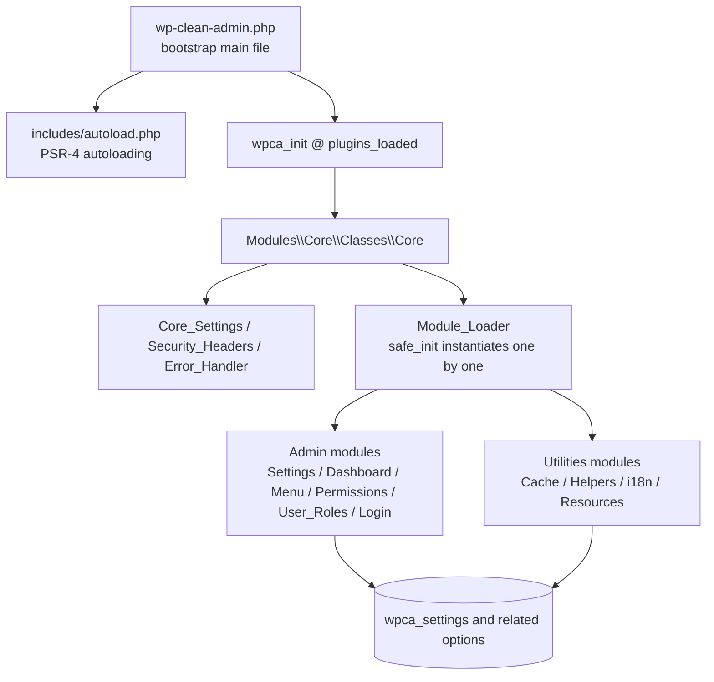

# WP Clean Admin Project Overview (English)

> **Applies to**: 1.9.18  |  **Last updated**: 2026-11-25  |  **Status**: Current document
> Authoritative standards: [`CONTRIBUTING.md`](../CONTRIBUTING.md); version history: [`CHANGELOG.md`](../CHANGELOG.md); documentation index: [`docs/README.md`](README.md). This document describes only what the current code actually implements; forward-looking material lives in [`优化建议.md`](优化建议.md).
> The Simplified Chinese original is [`项目概述.md`](项目概述.md); when the two diverge, the Chinese original wins.

## Table of Contents

- [1. Background](#1-background)
- [2. Goals and Non-Goals](#2-goals-and-non-goals)
- [3. Technology Stack](#3-technology-stack)
- [4. Architecture](#4-architecture)
- [5. Source Tree Tour](#5-source-tree-tour)
- [6. Documentation Navigation and Version Control](#6-documentation-navigation-and-version-control)

---

## 1. Background

A default WordPress admin area contains a large number of low-adaptability elements (dashboard widgets, admin bar links, emoji, heartbeats, an open REST surface), and site administrators usually have to clean them up one by one using several plugins or scattered code snippets. WP Clean Admin (WPCA) consolidates **admin cleanup, performance optimization, login security, roles and permissions, and diagnostics** into a single plugin, avoiding the maintenance cost and conflict risk of stacking multiple plugins.

The project introduced the modular `modules/` structure in 1.8.0; 1.9.12–1.9.13 settled the architecture (E-1): `WPCleanAdmin\Modules\*` is the single authoritative runtime system, and the dead legacy classes under the root `includes/class-wpca-*.php` were archived into `archive/legacy-includes-1.9.12/` (read-only); 1.9.17 completed the settings-page asset extraction (E-2) and the >200-line file governance (A-3). The current version is **1.9.18**.

## 2. Goals and Non-Goals

### 2.1 Design goals

| Goal | Description | Module |
|------|-------------|--------|
| Streamlined admin | Hide dashboard widgets, simplify the menu and the admin bar, and customize per role | `Admin\Classes\Menu_Manager`, `Menu_Customizer` |
| Better performance | Disable emoji/embed/heartbeat, database optimization switches, a three-tier cache entry point | `Utilities\Classes\Resources`, `Cache` |
| Login and access security | Image captcha, TOTP two-factor, failure lockout, security headers, REST restriction | `Admin\Classes\Login*`, `Core\Classes\Security_Headers` |
| Precise permissions | Capability checks per feature, restricted admin page access, custom roles and capabilities | `Admin\Classes\Permissions`, `User_Roles` |
| Observability and maintainability | System information/diagnostics, unified error codes and logging, governance splitting via task traits | `Dashboard_Data`, `Error_Handler`, `Utilities\Classes\Helpers` |

### 2.2 Non-goals (explicitly out of scope)

- It does not replace a dedicated object-cache or page-cache plugin; the `Cache` here is a lightweight TIER facade (memory/database/file).
- It does not modify front-end post content and provides no SEO, form or e-commerce features.
- It currently provides **no REST API endpoints** (no `register_rest_route` in the runtime code); the external interface consists of AJAX actions on WordPress `admin-ajax.php`, see [`API接口文档.md`](API接口文档.md).
- The archive layer `archive/` is read-only, does not participate in the runtime and is never ported back into the plugin.

## 3. Technology Stack

| Layer | Choice | Constraints and rationale |
|-------|--------|---------------------------|
| Runtime | PHP ≥ 7.4, WordPress ≥ 5.0, MySQL ≥ 5.6 | Declared in the plugin header; PHP 7.4 is the minimum syntax baseline |
| Autoloading | PSR-4 (`includes/autoload.php` plus a fallback loader in the bootstrap file) | `WPCleanAdmin\Modules\*` → `includes/modules/{admin,core,utilities}/...`; `WPCleanAdmin\AJAX\Settings` → `includes/ajax/settings-ajax.php` |
| Code organization | Namespaces + task traits + composed traits | No source file exceeds 200 lines (except registered exemptions); public APIs stay stable; see `CONTRIBUTING.md` §4.5 |
| Front end | Native admin jQuery and plain CSS, no build step | Assets are injected through `wp_enqueue_script`/`wp_enqueue_style`; settings page assets live in `modules/admin/settings/assets/` |
| Internationalization | `WPCA_TEXT_DOMAIN = 'wp-clean-admin'`, POT/PO/MO | Translation files live in `wpcleanadmin/languages/` |
| Tooling | Composer + PHPUnit + PHPStan + PHPCS | Configuration files are ready (`phpunit.xml.dist`, `phpstan.neon.dist`, `phpcs.xml.dist`); without a local PHP runtime only CI can verify |
| Release | GitHub Actions CI green → automatic Release via `release.yml` | Single long-lived branch `main`; see `CONTRIBUTING.md` §9.4 |
| License | GPLv2 or later | See [`LICENSE`](../LICENSE) |

## 4. Architecture

### 4.1 Layer overview



### 4.2 Bootstrap chain (code facts)

| Step | Location | Behaviour |
|------|----------|-----------|
| Constant definitions | `wpcleanadmin/wp-clean-admin.php:23-26` | `WPCA_VERSION`, `WPCA_PLUGIN_DIR`, `WPCA_PLUGIN_URL`, `WPCA_TEXT_DOMAIN` |
| Autoload registration | `wp-clean-admin.php:29-31`, `includes/autoload.php:32-105` | PSR-4 mapping for the module classes and `WPCleanAdmin\AJAX\Settings`; fallback loader at `:40-60` |
| Initialization hook | `wp-clean-admin.php:70-101` | `plugins_loaded` → `wpca_init()`: loads the textdomain (`:76`) and instantiates `Core::getInstance()` (`:81-83`); exceptions are logged |
| Core assembly | `modules/core/classes/class-wpca-core.php:76-97` | Includes `includes/wpca-core-functions.php` (`:79`); assembles `Security_Headers` (`:85`), `Module_Loader` (`:86`), `Core_Settings` (`:87`); legacy calls are explicitly commented out (`:93-95`) |
| Module loading | `modules/core/classes/class-wpca-module-loader.php:90-120` | `safe_init()` catches `Throwable`; order: `Settings` → `Error_Handler` → `Dashboard/Menu_Manager/Menu_Customizer/Permissions/User_Roles/Login` → `Cache/Helpers/i18n/Resources` |
| Activation / deactivation | `wp-clean-admin.php:139-190` / `:194-209` | Activation merges the default settings and calls `flush_rewrite_rules()`; deactivation only flushes; no data is deleted |
| Uninstall | `uninstall.php` | Deletes `wpca_*` options/transients/usermeta; since 1.9.18 it also clears WP-Cron events and the file cache directory (`uploads/wpca-cache`); backup and log directories still need manual cleanup |

### 4.3 Configuration and data flow

```mermaid
flowchart LR
    UI[Settings page / AJAX request] --> V[nonce check + manage_options]
    V --> S[Recursive sanitization]
    S --> O[(wpca_settings)]
    O --> R[wpca_get_settings()]
    R --> M[Modules read their switches]
    M --> H[admin_menu / wp_dashboard_setup / authenticate / init hooks]
    H --> W[Admin interface / login page / database and cache behaviour]
```

- **Write path**: the settings page uses `register_setting('wp-clean-admin', 'wpca_settings')` and the menu customizer AJAX writes `wpca_menu_customizer_settings`; both go through recursive sanitization. The `wpca_update_settings` filter allows third-party intervention before the write (`includes/wpca-core-settings-functions.php`). The three handler methods in `includes/ajax/settings-ajax.php` that were never registered were removed in 1.9.18; only the backward-compatible `Settings::sanitize_settings()` proxy remains (the single sanitization implementation is `Helpers::sanitize_settings()`).
- **Read path**: `wpca_get_settings()` (`wpca-core-settings-functions.php`) reads the option; since 1.9.18 it is memoized per request (`$GLOBALS['wpca_settings_cache']`), and the write path `wpca_update_settings()` invalidates that cache automatically (OPT-008).
- **Cache**: `Utilities\Classes\Cache` provides `get/set/delete/clear` and dispatches to the `memory` / `database` / `file` backends; the file backend uses JSON (PHP `serialize` is no longer used).

### 4.4 Key architecture decisions

| Decision | Version | Outcome |
|----------|---------|---------|
| E-1 architecture verdict | 1.9.12–1.9.13 | `modules/` is the single authoritative system; 115 legacy root classes archived; `WPCA_DISABLE_LEGACY` disables the old system by default |
| E-2 asset extraction | 1.9.17 | Inline CSS/JS on the live settings page extracted to `assets/` and injected by `Settings_Styles` / `Settings_Scripts` |
| A-3 governance split | 1.9.16 | Every live file above 200 lines split by task trait / composed trait; only 2 registered exemptions remain (the function stub, the bootstrap main file) |
| Security baseline | from 1.9.2 | Nonce + `manage_options` on AJAX writes; recursive input sanitization; SQL `prepare`; `realpath` boundary checks on backup deletion |

## 5. Source Tree Tour

```text
wpcleanadmin/
├── wp-clean-admin.php              # Bootstrap main file: constants, autoload, init, activation/deactivation
├── uninstall.php                   # Uninstall cleanup
├── includes/
│   ├── autoload.php                # PSR-4 autoloading
│   ├── ajax/settings-ajax.php      # Settings AJAX compatibility layer (sanitize_settings proxy only since 1.9.18)
│   ├── ajax/response-ajax.php       # Unified AJAX response DTO factory (WPCleanAdmin\AJAX\Response)
│   ├── wpca-core-*-functions.php   # Global wpca_* functions (settings/path/admin/utilities)
│   └── modules/
│       ├── core/classes/           # Core, Module_Loader, Error_Handler, Security_Headers
│       ├── admin/classes/          # Dashboard, menus, permissions, roles, login and 2FA
│       ├── admin/settings/         # Settings page rendering / fields / styles / scripts
│       └── utilities/classes/      # Cache, Helpers, Resources, i18n, Diagnostics
├── assets/                         # Shared admin CSS/JS (including the extracted settings page assets)
├── languages/                      # POT / PO / MO
└── tests/                          # PHPUnit cases and the autoload smoke test
prototype/                          # Four static prototype files, not loaded at runtime
```

> Detailed directory rules and naming conventions live in `CONTRIBUTING.md` §2–§3; per-module feature descriptions live in [`功能模块说明.md`](功能模块说明.md).

## 6. Documentation Navigation and Version Control

| Document | Purpose |
|----------|---------|
| [`installation-guide.en.md`](installation-guide.en.md) | Environment requirements, installation, multi-environment setups, verification |
| [`功能模块说明.md`](功能模块说明.md) | Module responsibilities, business flow diagrams, key logic |
| [`API接口文档.md`](API接口文档.md) / [`openapi.yaml`](openapi.yaml) | HTTP interface and the OpenAPI 3.1 contract |
| [`user-guide.en.md`](user-guide.en.md) | Roles, capabilities and step-by-step procedures |
| [`faq-troubleshooting.en.md`](faq-troubleshooting.en.md) | FAQ and troubleshooting matrix |
| [`优化建议.md`](优化建议.md) | Evaluation conclusions, implementation plans and priorities |
| [`tasks.md`](tasks.md) | Unfinished items, pending verifications and planned work |

| Document version | Applies to plugin version | Date | Maintainer | Summary |
|------------------|---------------------------|------|------------|---------|
| 1.0 | 1.9.18 | 2026-11-25 | Tanox | English mirror of `项目概述.md`: background, goals, technology stack, architecture and directory tour |
