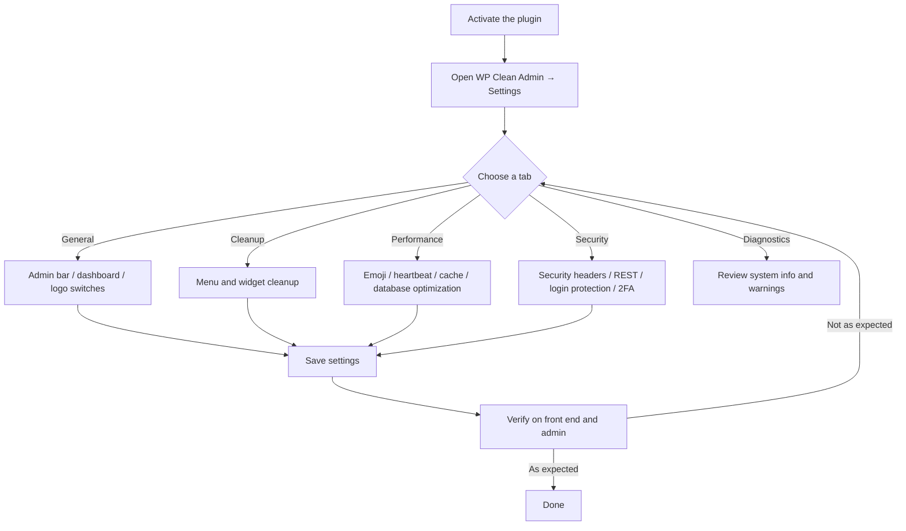

# WP Clean Admin User Guide (English)

> **Applies to**: 1.9.18  |  **Last updated**: 2026-11-26  |  **Status**: User documentation
> This document is aimed at site administrators and editors. See [`installation-guide.en.md`](installation-guide.en.md) for installation and [`faq-troubleshooting.en.md`](faq-troubleshooting.en.md) for common questions.
> The Simplified Chinese original is [`user-guide.md`](user-guide.md); when the two diverge, the Chinese original wins.

## Table of Contents

- [1. Roles and Capabilities](#1-roles-and-capabilities)
- [2. Quick Start](#2-quick-start)
- [3. Operation Flow Diagrams](#3-operation-flow-diagrams)
- [4. Settings Page: Step by Step](#4-settings-page-step-by-step)
- [5. Menu Customizer](#5-menu-customizer)
- [6. Database and Security Operations](#6-database-and-security-operations)
  - [6.1 Database backup / restore / delete](#61-database-backup--restore--delete)
  - [6.2 Login protection](#62-login-protection)
  - [6.3 REST restriction](#63-rest-restriction)
  - [6.4 Cache backend and cleanup](#64-cache-backend-and-cleanup)
  - [6.5 Diagnostics panel](#65-diagnostics-panel)
- [7. Save, Reset, Import and Export](#7-save-reset-import-and-export)
- [8. Document Version Control](#8-document-version-control)

---

## 1. Roles and Capabilities

| Role | Accessible scope | Key capabilities | Basis |
|------|------------------|------------------|------|
| Administrator | Settings page, menu customizer, database, permissions/roles, diagnostics | `manage_options`; all write operations require this capability | `modules/admin/classes/class-wpca-menu-customizer-ajax-tasks.php`, `includes/ajax/settings-ajax.php` |
| Editor | Only the default WordPress capabilities; the plugin grants nothing extra | Affected by `Permissions::filter_user_capabilities()` | `modules/admin/classes/class-wpca-permissions.php` |
| Author / Contributor / Subscriber | Default WordPress capabilities | No plugin settings entry point | `UserRolesDataCapabilitiesTasks::get_default_role_capabilities()` |
| Custom roles | Created by an administrator in the role manager | Capabilities can be added, removed, edited, and reset to built-in defaults | `UserRolesCapabilitiesTasks` |

> The `security.restrict_admin_access` setting can restrict access to specific admin pages. Test it with a secondary account before enabling it, so you do not lock yourself out of the admin (see the permissions and roles section).

## 2. Quick Start

1. Install and activate the plugin (see [`installation-guide.en.md`](installation-guide.en.md) §3).
2. Go to **WP Clean Admin → Settings** in the admin area; the page has five tabs: General / Cleanup / Performance / Security / Diagnostics.
3. Keep the defaults, enable features one by one, and verify the effect on both the front end and the admin area.
4. For 2FA: complete the TOTP binding with a test account first, then enforce the policy on other accounts.
5. For Chinese-language sites, use the bundled `wp-clean-admin-zh_CN.mo` translation file.

## 3. Operation Flow Diagrams

### 3.1 First-time configuration flow



### 3.2 Menu customizer flow

```mermaid
sequenceDiagram
    participant U as Administrator
    participant P as Settings page / customizer
    participant A as admin-ajax.php
    participant O as wpca_menu_customizer_settings
    U->>P: Open the menu customizer
    P->>A: action=wpca_save_menu_customizer + _wpnonce + settings
    A->>A: Verify nonce + manage_options
    A->>O: Sanitize and save
    O-->>U: success=true
    Note over U,O: Since 1.9.18 this option is the single data source;
    saved changes take effect immediately (OPT-001 fixed)
```

### 3.3 Enabling TOTP two-factor authentication

```mermaid
sequenceDiagram
    participant U as User
    participant L as Login page
    participant T as Login_TwoFactor
    U->>L: Submit username and password
    L->>T: wp_authenticate_user hook
    T->>U: Render the 2FA form (wpca_nonce)
    U->>T: Submit the TOTP code
    T->>T: Login_TOTP::verify()
    T-->>L: Success → logged in; failure → WP_Error
```

## 4. Settings Page: Step by Step

| Tab | Steps | Key settings | Effect scope |
|-----|-------|--------------|--------------|
| General | Tick or untick the admin bar, dashboard and WP logo switches → Save | `general.clean_admin_bar` / `clean_dashboard` / `remove_wp_logo` | Admin interface |
| Cleanup | Enable menu simplification and widget removal → pick specific widgets/menu items (optionally per role) → Save | `menu.remove_dashboard_widgets` / `simplify_admin_menu` / `dashboard_widgets` / `role_based_restrictions` | Admin menu and dashboard |
| Performance | Enable emoji/heartbeat/database optimization one by one → set the cache TTL → Save | `performance.disable_emojis` / `clean_transients` / `optimize_database` / `cache_enabled` / `cache_expiration` (seconds; values ≤ 0 fall back to 3600) | Front-end requests and cache |
| Security | Enable security headers, REST restriction and login protection → Save; 2FA requires binding each user first | `security.hide_wp_version` / `disable_xmlrpc` / `restrict_rest_api` / `restrict_admin_access` | Login and HTTP layer |
| Diagnostics | Review system information, run diagnostics, filter warnings by severity | `diagnostics.enable_diagnostics` / `auto_run_diagnostics` / `show_warnings` / `severity_filter` | Diagnostics panel |

- Container IDs: `wpca-settings-tabs`, `wpca-tabs-nav`, `wpca-tabs-content`; button IDs: `wpca-tab-general` / `wpca-tab-cleanup` / `wpca-tab-performance` / `wpca-tab-security` / `wpca-tab-diagnostics`; save button `wpca-save-button`, message area `wpca-save-message`. These are useful for browser automation and troubleshooting.
- Note: settings are read on the next request through `wpca_get_settings()`. No manual cache flush is required, but if you use an object-cache plugin, flush its cache so the updated option becomes visible.

## 5. Menu Customizer

1. Open the menu customizer and review the menu tree and admin bar nodes.
2. Select a menu item → set hidden, title, icon or order; items can be grouped.
3. Click Save (AJAX action `wpca_save_menu_customizer`); the message area shows success or failure.
4. Export: click Export to get JSON. Import: paste JSON and submit.
5. **Limitations**: since 1.9.18 the menu customizer uses a single `wpca_menu_customizer_settings` data source and all four endpoints are registered unconditionally, so saved changes take effect immediately. Sites carrying data from an older version are migrated automatically the first time the page is opened; no manual action is needed.

## 6. Database and Security Operations

### 6.1 Database backup / restore / delete

| Operation | Steps | Notes |
|-----------|-------|-------|
| Backup | Open the database management panel → click "Backup" → wait for the inline progress indicator → note the generated `.sql` file name | Backups are written to the plugin `backups/` directory; large tables take longer, so keep the page open |
| Restore | Select the target `.sql` file in the backup list → click "Restore" → confirm the impact and execute | **Overwrites the current database content** — take a fresh backup first |
| Delete backup | Select a file in the backup list → click "Delete" | Only file names with the `.sql` extension pass the whitelist, plus a `realpath` directory-boundary check (fixed in 1.9.2); files outside the directory cannot be deleted |

- Uninstalling the plugin **does not** delete backup files; clean up `wpcleanadmin/backups/` yourself (if it exists).
- Feedback is shown via inline status messages since 1.9.18 (no more `alert()`); watch the status area for long-running operations.

### 6.2 Login protection

| Feature | What the user does | Notes |
|---------|-------------------|-------|
| Image captcha | Types the characters shown on the login page | Requires PHP GD; without it the image cannot be generated and the login is rejected — contact an administrator |
| Failed-attempt lockout | Temporarily locked after reaching the failure threshold | The threshold is an internal constant of `Login_Attempts` |
| TOTP 2FA | Binds an authenticator app → enters the 6-digit code at login | Keep your recovery method safe; the form nonce is `wpca_nonce` |
| Login page customization | Sets the logo, background and title | Injected by the `Login_Style*` components |

### 6.3 REST restriction

`security.restrict_rest_api` registers the `rest_authentication_errors` filter during `rest_api_init`. Anonymous requests receive HTTP 403 (error code `rest_not_logged_in`); logged-in users are unaffected. To close REST entirely, still add restrictions at the server layer.

### 6.4 Cache backend and cleanup

1. Set `performance.cache_enabled` and `cache_expiration` (seconds; values ≤ 0 fall back to 3600) on the Performance tab.
2. The `Cache` module dispatches uniformly across the three backends (memory / database / file). The file backend writes to `wp-content/uploads/wpca-cache/` and needs that directory to be writable.
3. To flush manually, delete the `.cache` files under `uploads/wpca-cache/`; database cache entries use the `wpca_cache_%` prefix.
4. Expired entries are reclaimed by the hourly WP-Cron event `wpca_cache_cleanup`; the event is unscheduled when the plugin is deactivated or uninstalled.

### 6.5 Diagnostics panel

1. Open the Diagnostics tab and confirm `diagnostics.enable_diagnostics=1`; `auto_run_diagnostics` controls automatic execution.
2. Filter alerts by severity with `severity_filter`; `show_warnings` controls whether they are displayed.
3. Combine with the WordPress `WP_DEBUG`, browser Network and database checks in [`faq-troubleshooting.en.md`](faq-troubleshooting.en.md) §3 to locate problems.
4. Diagnostics are read-only — they never modify site configuration automatically.

## 7. Save, Reset, Import and Export

| Operation | Result | Risk note |
|-----------|--------|-----------|
| Save settings | Writes `wpca_settings`; recursive sanitization plus the `wpca_update_settings` filter | Nothing happens without a valid nonce and capability |
| Reset settings | Deletes the corresponding option and falls back to defaults | Existing configuration is lost — export a backup first |
| Reset menus | Clears `wpca_menu_items` / `wpca_menu_customizer_settings` | Irreversible |
| Import menu configuration | Writes JSON into `wpca_menu_customizer_settings` | Since 1.9.18 the read key matches, so imports take effect immediately (OPT-001) |

## 8. Document Version Control

| Document version | Applies to plugin version | Date | Maintainer | Summary |
|------------------|---------------------------|------|------------|---------|
| 1.1 | 1.9.18 | 2026-11-26 | Tanox | Expanded database backup/restore/delete steps, added cache backend and diagnostics sections; aligned with `user-guide.md` v1.2 |
| 1.0 | 1.9.18 | 2026-11-25 | Tanox | English mirror of `user-guide.md`: roles and capabilities, operation flow diagrams, five-tab walkthrough, database/security operations and limitations |
