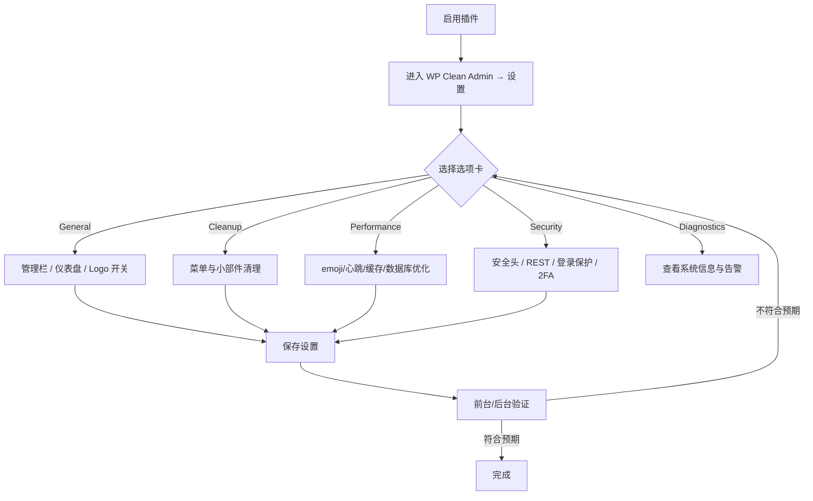
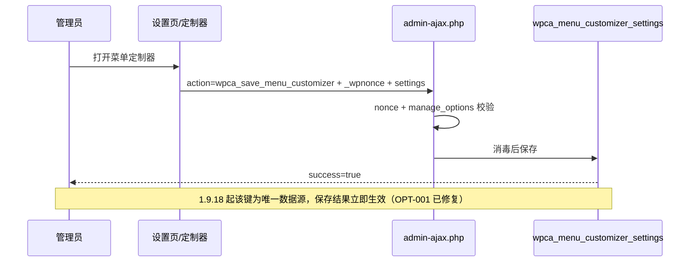
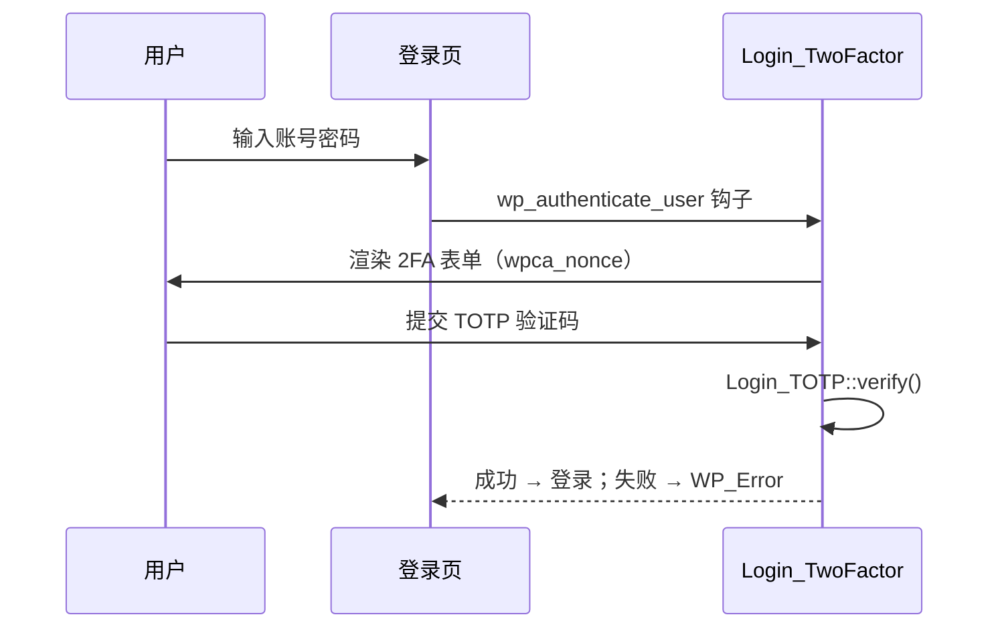

# WP Clean Admin 用户操作指南

> **适用基线**：1.9.18　|　**更新日期**：2026-11-26　|　**状态**：用户文档
> 本文面向站点管理员与编辑用户。安装部署见 [`安装部署指南.md`](安装部署指南.md)；常见问题见 [`FAQ与故障排除.md`](FAQ与故障排除.md)；功能背景见 [`功能模块说明.md`](功能模块说明.md)。

## 目录

- [1. 角色与权限说明](#1-角色与权限说明)
- [2. 快速开始](#2-快速开始)
- [3. 操作流程图](#3-操作流程图)
- [4. 设置页详细步骤](#4-设置页详细步骤)
- [5. 菜单定制器操作](#5-菜单定制器操作)
- [6. 数据库与安全操作](#6-数据库与安全操作)
  - [6.1 数据库备份/恢复/删除](#61-数据库备份恢复删除)
  - [6.2 登录保护](#62-登录保护)
  - [6.3 REST 限制](#63-rest-限制)
  - [6.4 缓存后端与清理](#64-缓存后端与清理)
  - [6.5 诊断面板](#65-诊断面板)
- [7. 保存、重置与导入导出](#7-保存重置与导入导出)
- [8. 文档版本控制](#8-文档版本控制)

---

## 1. 角色与权限说明

| 角色 | 可访问范围 | 关键能力 | 依据 |
|------|------------|----------|------|
| 管理员（Administrator） | 设置页、菜单定制、数据库、权限/角色、诊断 | `manage_options`；所有写操作要求此能力 | `modules/admin/classes/class-wpca-menu-customizer-ajax-tasks.php:41`、`includes/ajax/settings-ajax.php:39` |
| 编辑（Editor） | 仅其默认 WordPress 能力；插件不额外授权 | 受 `Permissions::filter_user_capabilities()` 影响 | `modules/admin/classes/class-wpca-permissions.php:87` |
| 作者 / 投稿者 / 订阅者 | 默认 WordPress 能力 | 不提供插件设置入口 | `UserRolesDataCapabilitiesTasks::get_default_role_capabilities()` |
| 自定义角色 | 由管理员在角色管理中创建 | 能力可增删改、可重置为内置默认值 | `UserRolesCapabilitiesTasks:69/116` |

> 权限设置项 `security.restrict_admin_access` 可限制指定后台页面访问；启用前请以测试账号验证，避免把自己锁在后台之外（见 `权限与角色管理` 章节）。

## 2. 快速开始

1. 安装并启用插件（见 [`安装部署指南.md`](安装部署指南.md) §3）。
2. 进入后台 **WP Clean Admin → 设置**；页面有 General / Cleanup / Performance / Security / Diagnostics 五个选项卡。
3. 保持默认开关，逐项启用功能并在前台/后台验证效果。
4. 需要 2FA 时：先用测试账号完成 TOTP 绑定，再对其他账号启用强制策略。
5. 亚洲语言环境（如中文）建议使用 `wp-clean-admin-zh_CN.mo` 翻译文件（已随包提供）。

## 3. 操作流程图

### 3.1 首次配置流程

### 3.2 菜单定制流程

### 3.3 管理员启用 TOTP 双因素流程

## 4. 设置页详细步骤

| 选项卡 | 操作步骤 | 关键配置项 | 生效范围 |
|--------|----------|------------|----------|
| General（常规） | 勾选/取消管理栏、仪表盘、WP Logo 开关 → 保存 | `general.clean_admin_bar` / `clean_dashboard` / `remove_wp_logo` | 后台界面 |
| Cleanup（清理） | 打开菜单简化与小部件移除 → 选择具体小部件/菜单项（按角色） → 保存 | `menu.remove_dashboard_widgets` / `simplify_admin_menu` / `dashboard_widgets` / `role_based_restrictions` | 后台菜单与仪表盘 |
| Performance（性能） | 逐项启用 emoji/心跳/数据库优化 → 设置缓存 TTL → 保存 | `performance.disable_emojis` / `clean_transients` / `optimize_database` / `cache_enabled` / `cache_expiration`（秒，≤0 回退 3600） | 前台请求与缓存 |
| Security（安全） | 启用安全头、REST 限制、登录保护 → 保存；2FA 需先完成用户绑定 | `security.hide_wp_version` / `disable_xmlrpc` / `restrict_rest_api` / `restrict_admin_access` | 登录与 HTTP 层 |
| Diagnostics（诊断） | 查看系统信息、运行诊断、按严重级别过滤告警 | `diagnostics.enable_diagnostics` / `auto_run_diagnostics` / `show_warnings` / `severity_filter` | 诊断面板 |

- 页面容器 ID：`wpca-settings-tabs`、`wpca-tabs-nav`、`wpca-tabs-content`；按钮 ID：`wpca-tab-general` / `wpca-tab-cleanup` / `wpca-tab-performance` / `wpca-tab-security` / `wpca-tab-diagnostics`；保存按钮 `wpca-save-button`，提示区 `wpca-save-message`。可用于浏览器自动化与问题定位。
- 提示：设置保存后由下一次请求通过 `wpca_get_settings()` 读取；无需手动清缓存，但如果使用对象缓存插件，请刷新其缓存以确保选项更新可见。

## 5. 菜单定制器操作

1. 进入菜单定制器，查看菜单树与管理栏节点。
2. 选择菜单项 → 设置隐藏、标题、图标或排序；可按分组组织。
3. 点击保存（AJAX action `wpca_save_menu_customizer`），提示区显示成功/失败。
4. 导出：点击导出获得 JSON；导入：粘贴 JSON 后提交。
5. **限制**：1.9.18 起菜单定制已统一 `wpca_menu_customizer_settings` 单一数据源、4 个接口无条件注册，保存后即时生效；若站点为旧版本遗留数据，首次打开时会自动迁移，无需手工处理。

## 6. 数据库与安全操作

### 6.1 数据库备份/恢复/删除

| 操作 | 步骤 | 注意事项 |
|------|------|----------|
| 备份 | 打开数据库管理面板 → 点击「备份」→ 等待进度提示完成 → 记录生成的 `.sql` 文件名 | 备份写入插件 `backups/` 目录；大表站点耗时较长，请勿关闭页面 |
| 恢复 | 在备份列表选择目标 `.sql` 文件 → 点击「恢复」→ 确认影响后执行 | **会覆盖当前数据库内容**，执行前先做一次新的备份 |
| 删除备份 | 在备份列表选择文件 → 点击「删除」 | 仅允许文件名与 `.sql` 扩展名白名单，并做 `realpath` 目录边界校验（1.9.2 修复），无法删除目录外文件 |

- 卸载插件**不会**自动删除备份文件，请自行清理 `wpcleanadmin/backups/`（如存在）。
- 反馈由页面内状态提示给出（1.9.18 起不再使用 `alert()`），进度较长时留意提示区。

### 6.2 登录保护

| 功能 | 用户操作 | 注意 |
|------|----------|------|
| 图形验证码 | 登录页输入图片字符 | 需 PHP GD；缺失时图片不可生成，登录会被拒绝，需联系管理员 |
| 失败锁定 | 连续失败达到阈值后暂时锁定 | 阈值由 `Login_Attempts` 内部常量控制 |
| TOTP 2FA | 绑定验证器 App → 登录时输入 6 位动态码 | 请妥善保存恢复方式；表单 nonce 为 `wpca_nonce` |
| 登录页定制 | 设置 LOGO/背景/标题 | 由 `Login_Style*` 组件注入 |

### 6.3 REST 限制

`security.restrict_rest_api` 在 `rest_api_init` 阶段注册 `rest_authentication_errors` 过滤，匿名请求返回 403（错误码 `rest_not_logged_in`），已登录用户不受影响。若需彻底关闭 REST，仍建议在服务器层额外限制。

### 6.4 缓存后端与清理

1. 在 Performance 选项卡设置 `performance.cache_enabled` 与 `cache_expiration`（秒；≤0 回退 3600）。
2. 三种后端（memory / database / file）由 `Cache` 模块统一分发；选择 file 时写入 `wp-content/uploads/wpca-cache/`，目录需可写。
3. 手动清空：删除 `uploads/wpca-cache/` 下的 `.cache` 文件即可；数据库缓存项前缀为 `wpca_cache_%`。
4. 过期项由 hourly WP-Cron 事件 `wpca_cache_cleanup` 回收，无需手动维护；停用/卸载插件时事件会被注销。

### 6.5 诊断面板

1. 打开 Diagnostics 选项卡，确认 `diagnostics.enable_diagnostics=1`；`auto_run_diagnostics` 控制是否自动执行。
2. 用 `severity_filter` 按严重级别过滤告警，`show_warnings` 控制告警展示。
3. 结合 [`FAQ与故障排除.md`](FAQ与故障排除.md) §3 的 WordPress `WP_DEBUG`、浏览器 Network 与数据库核对方法定位问题。
4. 诊断结果仅供排查，不自动修改站点配置。

## 7. 保存、重置与导入导出

| 操作 | 结果 | 风险提示 |
|------|------|----------|
| 保存设置 | 写 `wpca_settings`；经递归消毒与 `wpca_update_settings` 过滤器 | 无 nonce/权限时不执行 |
| 重置设置 | 删除对应选项并回落默认 | 会丢失已有配置，请先导出备份 |
| 重置菜单 | 清空 `wpca_menu_items` / `wpca_menu_customizer_settings` | 不可撤销 |
| 导入菜单配置 | JSON 写入 `wpca_menu_customizer_settings` | 1.9.18 起读键一致，导入即时生效（OPT-001） |

## 8. 文档版本控制

| 文档版本 | 适用插件版本 | 日期 | 维护人 | 变更摘要 |
|----------|--------------|------|--------|----------|
| 1.2 | 1.9.18 | 2026-11-26 | Tanox | 补充数据库备份/恢复/删除、缓存后端与清理、诊断面板操作步骤；移除已过时的「菜单定制已知问题」标注 |
| 1.1 | 1.9.18 | 2026-11-25 | Tanox | OPT-001 落地后更新菜单定制保存/导入说明；REST 限制章节改为 403 语义 |
| 1.0 | 1.9.17 | 2026-11-25 | Tanox | 首版：角色权限表、操作流程图、五 Tab 详细步骤、数据库/安全操作与限制说明 |
