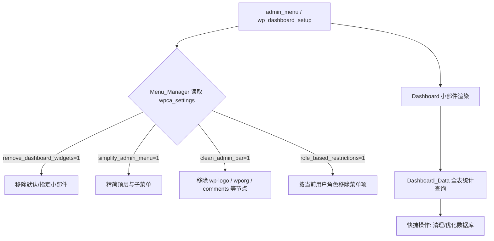
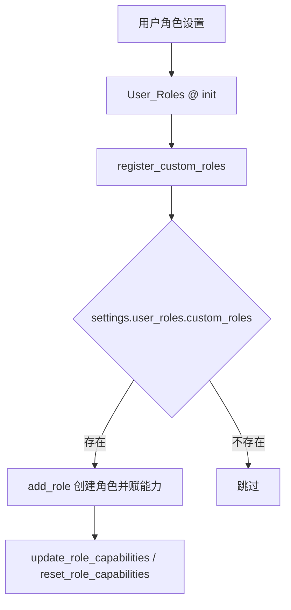
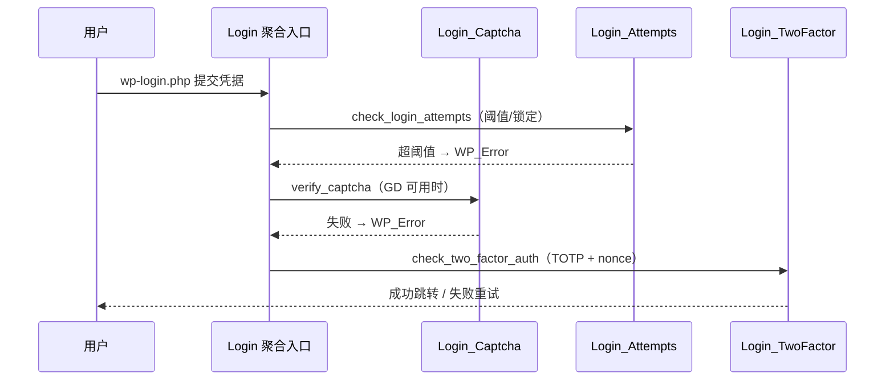
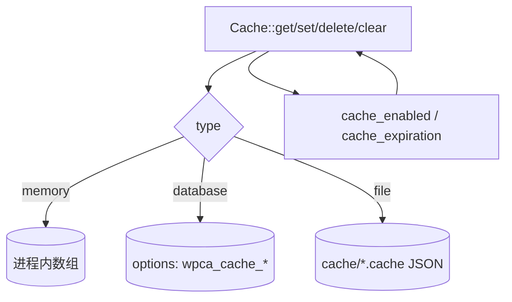
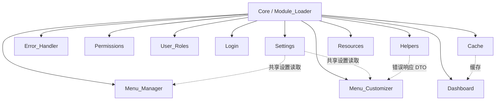

# WP Clean Admin 功能模块说明

> **适用基线**：1.9.18　|　**更新日期**：2026-11-25　|　**状态**：现行文档
> 权威实现：`wpcleanadmin/includes/modules/**`（根 legacy 类已归档，不作为实现依据）。术语见 `CONTRIBUTING.md` §10；优化项见 [`优化建议.md`](优化建议.md)。

## 目录

- [1. 模块总览](#1-模块总览)
- [2. 后台清理与仪表盘](#2-后台清理与仪表盘)
- [3. 菜单定制器](#3-菜单定制器)
- [4. 权限与角色管理](#4-权限与角色管理)
- [5. 安全、登录与双因素](#5-安全登录与双因素)
- [6. 性能、缓存与资源优化](#6-性能缓存与资源优化)
- [7. 诊断、日志与设置中心](#7-诊断日志与设置中心)
- [8. 跨模块调用关系与已知限制](#8-跨模块调用关系与已知限制)
- [9. 文档版本控制](#9-文档版本控制)

---

## 1. 模块总览

| 功能域 | 入口类（命名空间省略 `WPCleanAdmin\Modules\`） | 用户可见能力 | 配置来源 |
|--------|-----------------------------------------------|--------------|----------|
| 仪表盘 | `Admin\Classes\Dashboard` | 统计小部件、快捷操作（清理/优化数据库） | `general` / `diagnostics` |
| 菜单管理 | `Admin\Classes\Menu_Manager` | 移除小部件、简化菜单、管理栏清理、角色限制 | `menu.*`、`general.clean_admin_bar` |
| 菜单定制 | `Admin\Classes\Menu_Customizer` | 菜单项隐藏/改名/排序/分组、管理栏节点定制、导入导出 | `wpca_menu_customizer_settings` |
| 权限 | `Admin\Classes\Permissions` | 功能点权限、后台页面访问限制 | `security.restrict_admin_access` |
| 角色 | `Admin\Classes\User_Roles` | 自定义角色增删改、能力调整与重置 | `user_roles.custom_roles` |
| 登录安全 | `Admin\Classes\Login*` | 验证码、失败锁定、TOTP 2FA、登录页定制 | `security`/`general` 相关开关 |
| 性能资源 | `Utilities\Classes\Resources` | emoji/embed/心跳/工具栏优化、REST 限制 | `performance.*`、`resources.*` |
| 缓存 | `Utilities\Classes\Cache` | memory/database/file 三级缓存门面 | `performance.cache_enabled/cache_expiration` |
| 诊断 | `Admin\Classes\Dashboard_Data`、`Utilities\Classes\Diagnostics` | 系统信息、健康检查、告警过滤 | `diagnostics.*` |
| 设置中心 | `Admin\Settings\Settings` | 五 Tab 设置页、字段注册、资源注入 | `wpca_settings` |

> 类名与行号证据见 `openspec/specs/plugin-architecture/detailed-design.md` 与本仓库代码；本文只描述用户可观察行为。

## 2. 后台清理与仪表盘

### 2.1 核心逻辑

- `Dashboard::init()`（`modules/admin/classes/class-wpca-dashboard.php:67`）注册小部件（`:70`）与后台脚本（`:73`）；脚本仅加载于 `index.php`。
- `Dashboard_Data::get_dashboard_stats()` 提供统计：数据库/瞬态/meta 估算、系统信息；`DashboardDataTasks::run_quick_action()` 支持 `cleanup_database` / `optimize_database` 快捷操作（同目录 `class-wpca-dashboard-data-tasks.php:50-73`）。
- `Menu_Manager::init()`（`:78`）按开关挂载：`wp_dashboard_setup` 移除小部件（`:86`）、`admin_bar_menu` 清理管理栏（`:94`）、`admin_menu` 应用角色限制（`:98`）。小部件粒度配置位于 `menu.dashboard_widgets`。

### 2.2 业务流程图

> 统计查询为同步执行且含前导通配符 `LIKE '%transient%'`，见 OPT-010。

## 3. 菜单定制器

### 3.1 核心能力

`Menu_Customizer`（`modules/admin/classes/class-wpca-menu-customizer.php`）通过任务 trait 提供：

- 菜单项：隐藏、标题替换、图标替换、位置调整（`MenuCustomizerTreeCustomizeTasks`、`MenuCustomizerTreeOrderTasks`）。
- 管理栏节点：隐藏、标题替换（`Menu_Customizer_Render`）。
- 菜单分组：`create_menu_group` / `update_menu_group` / `delete_menu_group` / `get_menu_groups`（`MenuCustomizerDelegationTasks`）。
- 导入导出：`export_settings()` / `import_settings()`（`Menu_Customizer_Render:142/163`）。
- 4 个 AJAX action：保存、重置、导出、导入（注册于 `class-wpca-menu-customizer.php:95-100`；处理器 `class-wpca-menu-customizer-ajax-tasks.php`），均校验 `_wpnonce`（`wpca_ajax_nonce`）与 `manage_options`。

### 3.2 数据流与已知限制

**实施状态（1.9.18 起已修复）**：菜单定制现以 `wpca_menu_customizer_settings` 为**唯一数据源**（`Menu_Customizer_Options` 统一读写，Tree/Render 通过构造器注入同一实例），4 个 AJAX action **无条件注册**，旧版 `wpca_settings.menu_customizer` 数据在首次读取时幂等迁移。根因与修复见 OPT-001。

## 4. 权限与角色管理

### 4.1 功能点权限

- `Permissions::init()`（`modules/admin/classes/class-wpca-permissions.php:73`）挂 `user_has_cap`；`filter_user_capabilities()`（`:87`）按能力映射调整当前用户能力。
- `Permissions_Checker::has_feature_permission()` 计算某功能点是否允许；`Permissions_Restrict::restrict_admin_access()` / `restrict_specific_admin_pages()` 限制后台访问（同目录）。
- 用户侧能力要求：所有设置写操作均要求 `manage_options`；详见 [`user-guide.md`](user-guide.md) 角色表。

### 4.2 自定义角色

- 默认能力表位于 `UserRolesDataCapabilitiesTasks::get_default_role_capabilities()`（管理员/编辑/作者/投稿者/订阅者）。
- 角色数据写入 WordPress `wp_user_roles`；`user_roles` 键无默认设置，需显式配置（见 `安装部署指南.md` §4.2）。

## 5. 安全、登录与双因素

### 5.1 登录流程

- `Login::init()`（`modules/admin/classes/class-wpca-login.php:99`）判定验证码图片请求（`:101`）、挂载登录钩子（`:107-111`）并初始化四个子组件（`:114-116`）。
- TOTP 实现：`Login_TOTP::verify()/generate_otp()/base32_decode()`；密钥写 user meta（`LoginTwoFactorSecretTasks:37-38`）。
- 安全响应头：`Core\Classes\Security_Headers::send_security_headers()` 经 `send_headers` 输出 CSP/X-Frame-Options 等（同目录 `class-wpca-security-headers.php:31-55,63`）。
- 错误处理器：`Core\Classes\Error_Handler` 注册 `set_error_handler` / `set_exception_handler` / shutdown（`:80-92`）；Helpers 另有一套注册方法，存在冲突风险（OPT-004）。

## 6. 性能、缓存与资源优化

### 6.1 资源优化

`Resources::init()`（`modules/utilities/classes/class-wpca-resources.php:60`）挂前台/后台 enqueue（`:63-64`）：禁用 emoji、embed、心跳、管理工具栏与部分 widget；REST 限制通过 `rest_authentication_errors` 实现但注册时机在 `wp_enqueue_scripts`，纯 REST 请求不会触发（OPT-005）。

### 6.2 缓存分发

- 门面：`CacheApiTasks`（`get/set/delete/clear`）；三个后端分别由 `CacheMemoryTasks` / `CacheDatabaseTasks` / `CacheFileTasks` 实现。
- 数据库清理：`SELECT option_name ... LIKE 'wpca_cache_%'` 无 LIMIT，逐条删除；无 cron 过期兜底（OPT-006）。
- 文件缓存：位于插件目录、`init()` 每次全目录 `glob` 清理、写入非原子（OPT-007）。
- 旧 PHP 序列化格式已改为 JSON，读取时损坏文件自动丢弃。

## 7. 诊断、日志与设置中心

- **设置中心**：`Admin\Settings\Settings` 注册 `admin_menu`（`:45`）、`admin_init`（`:46`）、`admin_enqueue_scripts`（`:47`）；字段注册在 `SettingsRegistrationTasks`，每个 Tab 使用独立页面标识（`wp-clean-admin-general|cleanup|performance|security`）避免重复渲染，样式/脚本由 `Settings_Styles` / `Settings_Scripts` 从 `assets/` 注入（E-2）。
- **诊断**：`Dashboard_Data::get_system_info()`、`Utilities\Classes\Diagnostics`、日志组件 `File_Logger`；设置项 `diagnostics.enable_diagnostics/auto_run_diagnostics/show_warnings/severity_filter` 控制行为。仪表盘统计结果以 15 分钟 transient 缓存，避免每次访问执行全表统计（OPT-010）。
- **日志**：错误统一由 `Error_Handler` 注册的全局处理器记录（唯一注册点），`Helpers::log` 保留为调试期辅助输出。

## 8. 跨模块调用关系与已知限制

**当前已知限制（1.9.18 实施后）**：

| 编号 | 状态 | 说明 |
|------|------|------|
| OPT-001 | 已修复 | 菜单定制统一 `wpca_menu_customizer_settings`，AJAX 无条件注册，含 legacy 迁移 |
| OPT-002 | 已修复 | 统一 `WPCleanAdmin\AJAX\Response` 契约；移除未挂载的 settings handler |
| OPT-003 | 已修复 | 设置字段回显改读 `wpca_settings` 嵌套结构，表单名同步为 `wpca_settings[group][id]` |
| OPT-004 | 已修复 | `Error_Handler` 为唯一全局注册点，Helpers 处理器不再吞错 |
| OPT-005 | 已修复 | REST 限制改在 `rest_api_init` 注册，匿名请求返回 403 |
| OPT-006~OPT-008 | 已修复 | 缓存分批清理 + cron 兜底、文件缓存原子写入与目录迁移、设置读取记忆化 |
| OPT-009~OPT-012 | 已修复 | Tab 唯一渲染 + ARIA、前端移除 `alert()`/`.html()`、统计 transient 化、覆盖率门禁工具与卸载清理补全 |
| 覆盖率基线 | 待确认 | CI 新增 coverage 作业首次仅报告基线，确认 ≥70% 后再启用阻塞 |

完整实施细节见 [`优化建议.md`](优化建议.md)；任务状态与计划时间见 [`tasks.md`](tasks.md)。

## 9. 文档版本控制

| 文档版本 | 适用插件版本 | 日期 | 维护人 | 变更摘要 |
|----------|--------------|------|--------|----------|
| 1.0 | 1.9.17 | 2026-11-25 | Tanox | 首版：模块总览、业务流程图、关键逻辑与已知限制 |
