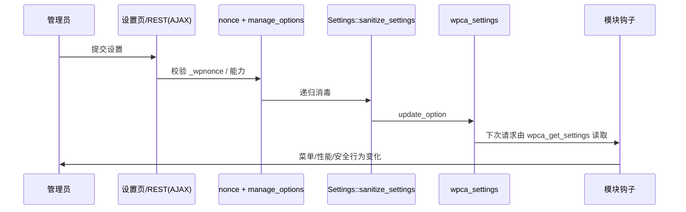

# WP Clean Admin 安装部署指南

> **适用基线**：1.9.18　|　**更新日期**：2026-11-25　|　**状态**：现行文档
> 面向：站点管理员、运维与开发者。安装前请阅读 [§1 环境依赖](#1-环境依赖清单)；功能说明见 [`功能模块说明.md`](功能模块说明.md)。

## 目录

- [1. 环境依赖清单](#1-环境依赖清单)
- [2. 获取分发包](#2-获取分发包)
- [3. 标准安装流程](#3-标准安装流程)
- [4. 安装后配置步骤](#4-安装后配置步骤)
- [5. 多环境部署方案](#5-多环境部署方案)
- [6. 验证方法](#6-验证方法)
- [7. 升级、回滚与卸载](#7-升级回滚与卸载)
- [8. 文档版本控制](#8-文档版本控制)

---

## 1. 环境依赖清单

| 依赖 | 最低版本 / 条件 | 必要性 | 说明与代码依据 |
|------|-----------------|--------|----------------|
| WordPress | ≥ 5.0 | 必需 | 插件头声明；`wpca_is_wp_version_gte()` 位于 `includes/wpca-core-util-functions.php:61` |
| PHP | ≥ 7.4 | 必需 | 插件头与 `composer.json`；CI 含 PHP 7.4 语法 lint |
| MySQL | ≥ 5.6 | 必需 | 插件读取/写入 options 与 usermeta；`uninstall.php` 直接执行 SQL |
| PHP GD 扩展 | 任意可用版本 | 条件必需 | 登录图形验证码依赖；缺失时图片生成被安全跳过，登录校验会拒绝缺验证码请求（见 `modules/admin/classes/class-wpca-login-captcha.php`） |
| 文件系统写权限 | `wp-content/uploads/wpca-cache/` 可写 | 条件必需 | 1.9.18 起文件缓存目录迁出插件目录（含 `index.php` 与 `.htaccess` 防护），写入采用原子替换；缺失时建议切换 memory/database 后端 |
| 对象缓存（Redis/Memcached） | 可选 | 可选 | 本插件未直接对接；第三方 drop-in 可作为补充，见 OPT-007 |
| 浏览器 | 现代浏览器（支持 ES6） | 必需 | 设置页与管理栏脚本无 IE 兼容构建 |

> 依赖事实来自 `wp-clean-admin.php`、`composer.json`、`uninstall.php` 与模块代码；本机无 PHP 运行时，所有运行期校验以 CI/实际站点为准。

## 2. 获取分发包

1. 推荐：GitHub Releases 下载 `wp-clean-admin.zip`（CI 全绿后由 `release.yml` 自动发布）。
2. 开发/测试：从仓库 `main` 分支检出源码，在 `wpcleanadmin/` 下执行 `composer install --no-dev`（需要本机 PHP/Composer）。
3. 校验：核对包内存在 `wp-clean-admin.php`（`Version: 1.9.18`）、`includes/autoload.php`、`includes/modules/` 与 `uninstall.php`；缺任一项视为不完整包。

## 3. 标准安装流程

### 3.1 WordPress 后台上传（推荐）

```text
后台 → 插件 → 安装插件 → 上传插件 → 选择 wp-clean-admin.zip → 现在安装 → 启用
```

1. 上传前确认站点已备份（数据库与 `wp-content/`）。
2. 激活时执行 `wp-clean-admin.php:139-190`：写入默认 `wpca_settings`（已存在的值保留）、`flush_rewrite_rules()`。
3. 验证插件列表中出现 **Settings / 设置** 快捷链接（`wp-clean-admin.php:218-233`）。

### 3.2 手工 FTP 安装

1. 解压归档，将 `wpcleanadmin/` 目录上传至 `wp-content/plugins/`（目标路径示例：`wp-content/plugins/wp-clean-admin/`）。
2. 后台 → 插件 → 已安装插件 → 启用 WP Clean Admin。
3. 若目录名不是 `wp-clean-admin`，插件仍可运行（常量基于 `WPCA_PLUGIN_DIR`/`WPCA_PLUGIN_URL`），但语言文件与更新检查可能受影响，建议保持标准目录名。

### 3.3 停用与卸载

- 停用：仅 `flush_rewrite_rules()`，**保留全部设置**（`wp-clean-admin.php:194-209`）。
- 卸载：后台删除插件触发 `uninstall.php`，删除 6 个已知 option、所有 `wpca_%` option、`_transient_wpca_%` 与 `wpca_%` usermeta；1.9.18 起额外清理 WP-Cron 事件与文件缓存目录（`uploads/wpca-cache`），备份与日志目录仍需手动清理。

## 4. 安装后配置步骤

### 4.1 入口与选项卡

后台 → **WP Clean Admin → 设置**。页面包含 General / Cleanup / Performance / Security / Diagnostics 五个选项卡；容器与按钮带语义化 ID（`wpca-settings-tabs`、`wpca-tab-general` 等），便于自动化与调试定位。

### 4.2 激活时写入的默认设置（`wp-clean-admin.php:142-169`）

| 分组 | 键 = 默认值 |
|------|-------------|
| `general` | `clean_admin_bar=1`、`clean_dashboard=1`、`remove_wp_logo=1` |
| `performance` | `optimize_database=1`、`clean_transients=1`、`disable_emojis=1` |
| `menu` | `remove_dashboard_widgets=1`、`simplify_admin_menu=1` |
| `security` | `hide_wp_version=1`、`disable_xmlrpc=1`、`restrict_rest_api=1`、`restrict_admin_access=1` |
| `diagnostics` | `enable_diagnostics=1`、`auto_run_diagnostics=0`、`show_warnings=1`、`severity_filter='all'` |

> 已存在的设置不会被默认值覆盖（`array_merge($default_settings, $current_settings)`，`:173-176`）。`user_roles` 无默认键，首次自定义角色时在对应模块创建。

### 4.3 保存与生效路径



- 写路径：设置页 `register_setting('wp-clean-admin', 'wpca_settings')`；菜单定制器 AJAX（`modules/admin/classes/class-wpca-menu-customizer-ajax-tasks.php`，写入 `wpca_menu_customizer_settings`）。原 `includes/ajax/settings-ajax.php` 的 3 个未挂载 handler 已于 1.9.18 移除，仅保留 `sanitize_settings()` 兼容代理。
- 读路径：`wpca_get_settings()`（`includes/wpca-core-settings-functions.php`），1.9.18 起请求级记忆化，写路径自动失效缓存。
- 第三方干预：`apply_filters('wpca_update_settings', $settings)`（`includes/wpca-core-settings-functions.php`）。

### 4.4 最小可用配置建议

1. 保持默认 `general`/`menu` 开关，先观察后台外观。
2. 性能项逐项打开（emoji/心跳/数据库优化），每次变更后验证站点前台与后台。
3. 安全项开启前确认：开启 `restrict_rest_api` 会使匿名 REST 请求返回 403（错误码 `rest_not_logged_in`），已登录用户不受影响；2FA 需用户完成 TOTP 绑定后再强制。
4. 需要登录验证码时确认 GD 扩展可用。

## 5. 多环境部署方案

| 环境 | 安装方式 | 配置差异 | 验证重点 |
|------|----------|----------|----------|
| 本地开发 | 源码检出 + `composer install`；插件目录软链/复制到 `wp-content/plugins/` | `WP_DEBUG=true`；使用 file/memory 缓存；禁用 2FA 强制以便调试 | `wpca_init()` 无异常日志；设置页五 Tab 可见；AJAX nonce 有效 |
| 预发布（Staging） | 与生产同版本 Release zip | 复制生产配置后脱敏；开启 diagnostics `show_warnings` | 与生产同 PHP/WP 版本；缓存/数据库清理不误删 |
| 生产（单站） | Release zip 后台上传 | 仅开启验证过的开关；`WP_DEBUG=false` | 首屏性能、登录流程、REST/验证码行为、备份恢复演练 |
| 生产（多站点） | 网络后台启用或逐站启用 | `Helpers::is_network_activated()` 提供网络激活检测（"plugins/utilities/classes/class-wpca-helpers-*-tasks.php"）；设置按站点存储 | 各站点 `wpca_settings` 独立；逐站验证角色/菜单定制 |
| CI | `composer install` + `composer test/phpstan/phpcs` | 使用 `phpunit.xml.dist` / `phpstan.neon.dist` / `phpcs.xml.dist` | workflow 成功才触发 `release.yml` 自动发布；`PHP_CodeSniffer` 与 `Coverage Gate` 当前为非阻塞（`continue-on-error: true`），状态见 [`tasks.md`](tasks.md) |

> 多环境一律使用同一版本包；配置差异通过 WordPress 选项管理，不在代码中写环境变量分支。

## 6. 验证方法

| 验证项 | 方法 | 期望结果 |
|--------|------|----------|
| 插件加载 | 激活后查看后台菜单与插件列表 Settings 链接 | 菜单与链接出现；`WP_DEBUG` 下无插件异常 |
| 默认配置 | 读取 `wpca_settings` 选项 | 含 §4.2 五组默认值；已有值未被覆盖 |
| 设置页渲染 | 打开设置页并用浏览器检查语义 ID | `wpca-settings-tabs` / `wpca-tab-*` 存在；样式脚本由 `assets/` 加载 |
| AJAX 写操作 | 浏览器保存菜单定制设置 | 返回 `success:true`；`wpca_menu_customizer_settings` 更新（1.9.18 起单一数据源，无条件注册） |
| 安全检查 | 未登录请求 AJAX；无 nonce 请求 | 均被拒绝（403/错误响应）；详见 [`API接口文档`](API接口文档.md) |
| 缓存行为 | `Cache::set/get/clear` 三种后端各写读一次 | 值一致；过期项被清理；文件缓存为 JSON 且位于 `uploads/wpca-cache/` |
| 卸载清理 | 在测试站删除插件后查 options/usermeta | `wpca_%` 键被删除；cron 事件与缓存目录被清理；备份与日志目录需手动清理 |

## 7. 升级、回滚与卸载

1. **升级**：备份 → 停用插件 → 覆盖 `wp-content/plugins/wp-clean-admin/` → 重新激活 → 按 §6 验证。激活逻辑不会覆盖已存设置。
2. **回滚**：恢复升级前插件目录与数据库备份；设置结构若变更，以备份的 `wpca_settings` 为准。
3. **卸载**：后台删除插件（触发 `uninstall.php`，自动清理 `wpca_%` 选项、cron 事件与 `uploads/wpca-cache`）；如需彻底清理，手动删除备份目录与日志目录。
4. 常见问题见 [`FAQ与故障排除.md`](FAQ与故障排除.md)；未解决项按 [`tasks.md`](tasks.md) 登记。

## 8. 文档版本控制

| 文档版本 | 适用插件版本 | 日期 | 维护人 | 变更摘要 |
|----------|--------------|------|--------|----------|
| 1.1 | 1.9.18 | 2026-11-25 | Tanox | 修正文件缓存目录为 `uploads/wpca-cache`（与 OPT-007 一致）；标注两个非阻塞 CI 门禁 |
| 1.0 | 1.9.17 | 2026-11-25 | Tanox | 首版：依赖清单、安装配置、多环境、验证与升级/卸载 |
