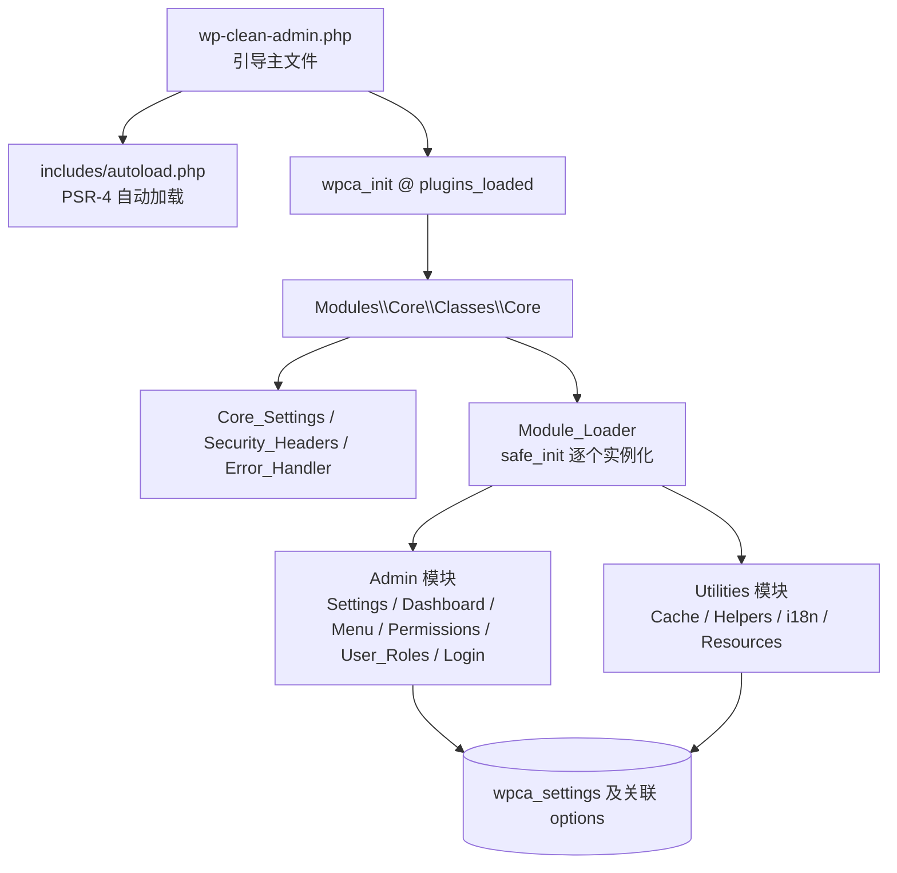

# WP Clean Admin 项目概述

> **适用基线**：1.9.17　|　**更新日期**：2026-11-25　|　**状态**：现行文档
> 权威规范：[`CONTRIBUTING.md`](../CONTRIBUTING.md)；版本历史：[`CHANGELOG.md`](../CHANGELOG.md)；文档索引：[`docs/README.md`](README.md)。本文只描述当前代码已实现的事实，前瞻内容见 [`优化建议.md`](优化建议.md)。

## 目录

- [1. 项目背景](#1-项目背景)
- [2. 目标与非目标](#2-目标与非目标)
- [3. 技术栈选型](#3-技术栈选型)
- [4. 架构设计](#4-架构设计)
- [5. 源码目录速览](#5-源码目录速览)
- [6. 文档导航与版本控制](#6-文档导航与版本控制)

---

## 1. 项目背景

WordPress 后台默认包含大量适应性较弱的元素（仪表盘小部件、管理栏外链、emoji、心跳、开放 REST 等），站点管理员通常需要通过多个插件或散落代码片段逐项清理。WP Clean Admin（WPCA）以一个插件集中提供**后台清理、性能优化、登录安全、权限角色与诊断**能力，避免多插件叠加带来的维护成本与冲突风险。

项目自 1.8.0 引入 `modules/` 模块化结构；1.9.12–1.9.13 完成架构定论（E-1）：`WPCleanAdmin\Modules\*` 为运行期唯一权威体系，旧的根 `includes/class-wpca-*.php` 死代码归档至 `archive/legacy-includes-1.9.12/`（只读）；1.9.17 完成设置页资源抽离（E-2）与 >200 行文件治理（A-3）。当前版本 **1.9.17**。

## 2. 目标与非目标

### 2.1 设计目标

| 目标 | 说明 | 对应模块 |
|------|------|----------|
| 后台精简 | 按设置隐藏仪表盘小部件、简化菜单与管理栏，支持按角色定制 | `Admin\Classes\Menu_Manager`、`Menu_Customizer` |
| 性能提升 | 禁用 emoji/embed/心跳、数据库优化开关、三级缓存入口 | `Utilities\Classes\Resources`、`Cache` |
| 登录与访问安全 | 图形验证码、TOTP 双因素、失败锁定、安全响应头、REST 限制 | `Admin\Classes\Login*`、`Core\Classes\Security_Headers` |
| 权限精细化 | 按功能点检查能力、限制后台页面访问、自定义角色与能力 | `Admin\Classes\Permissions`、`User_Roles` |
| 可观测可维护 | 系统信息/诊断、统一错误码与日志、任务 trait 治理拆分 | `Dashboard_Data`、`Error_Handler`、`Utilities\Classes\Helpers` |

### 2.2 非目标（明确不做）

- 不替代专业对象缓存/页面缓存插件；本插件的 `Cache` 是轻量级 TIER 门面（memory/database/file）。
- 不修改前台文章内容、不提供 SEO/表单/电商类功能。
- 当前**不提供 REST API 端点**（运行时代码无 `register_rest_route`）；对外交互为 WordPress `admin-ajax.php` 上的 AJAX action，详见 [`API接口文档`](API接口文档.md)。
- 归档层 `archive/` 只读，不参与运行、不再移植回插件。

## 3. 技术栈选型

| 层次 | 选型 | 约束与理由 |
|------|------|------------|
| 运行时 | PHP ≥ 7.4、WordPress ≥ 5.0、MySQL ≥ 5.6 | 插件头声明；PHP 7.4 为最低语法基线 |
| 自动加载 | PSR-4（`includes/autoload.php` + 引导文件兜底 loader） | `WPCleanAdmin\Modules\*` → `includes/modules/{admin,core,utilities}/...`；`WPCleanAdmin\AJAX\Settings` → `includes/ajax/settings-ajax.php` |
| 代码组织 | 命名空间 + 任务 trait + 组合 trait | 单文件不超过 200 行（登记排除项除外），公开 API 保持稳定；见 `CONTRIBUTING.md` §4.5 |
| 前端 | 后台原生 jQuery + 原生 CSS，无前端构建步骤 | 资源经 `wp_enqueue_script`/`wp_enqueue_style` 注入；设置页资源位于 `modules/admin/settings/assets/` |
| 国际化 | `WPCA_TEXT_DOMAIN = 'wp-clean-admin'`，POT/PO/MO | 翻译文件位于 `wpcleanadmin/languages/` |
| 开发工具 | Composer + PHPUnit + PHPStan + PHPCS | 配置文件就绪（`phpunit.xml.dist`、`phpstan.neon.dist`、`phpcs.xml.dist`）；本机无 PHP 时只能由 CI 验证 |
| 发布 | GitHub Actions CI 全绿 → `release.yml` 自动 Release | 唯一长期分支 `main`；见 `CONTRIBUTING.md` §9.4 |
| 许可 | GPLv2 或更高版本 | 见 [`LICENSE`](../LICENSE) |

## 4. 架构设计

### 4.1 分层概览



### 4.2 启动链（代码事实）

| 步骤 | 位置 | 行为 |
|------|------|------|
| 常量定义 | `wpcleanadmin/wp-clean-admin.php:23-26` | `WPCA_VERSION`、`WPCA_PLUGIN_DIR`、`WPCA_PLUGIN_URL`、`WPCA_TEXT_DOMAIN` |
| 注册自动加载 | `wp-clean-admin.php:29-31`、`includes/autoload.php:32-105` | PSR-4 映射模块类与 `WPCleanAdmin\AJAX\Settings`；备用 loader 见 `:40-60` |
| 初始化钩子 | `wp-clean-admin.php:70-101` | `plugins_loaded` → `wpca_init()`：加载 textdomain（`:76`）并实例化 `Core::getInstance()`（`:81-83`）；异常写日志 |
| 核心装配 | `modules/core/classes/class-wpca-core.php:76-97` | 引入 `includes/wpca-core-functions.php`（`:79`）；装配 `Security_Headers`（`:85`）、`Module_Loader`（`:86`）、`Core_Settings`（`:87`）；legacy 调用已显式注释（`:93-95`） |
| 模块装载 | `modules/core/classes/class-wpca-module-loader.php:90-120` | `safe_init()` 捕获 `Throwable`；顺序：`Settings` → `Error_Handler` → `Dashboard/Menu_Manager/Menu_Customizer/Permissions/User_Roles/Login` → `Cache/Helpers/i18n/Resources` |
| 激活 / 停用 | `wp-clean-admin.php:139-190` / `:194-209` | 激活合并默认设置并 `flush_rewrite_rules()`；停用仅 flush；不删除数据 |
| 卸载 | `uninstall.php:13-40` | 删除 `wpca_*` options/transients/usermeta；**不删除文件、不清理 cron**（见 [`优化建议.md`](优化建议.md) OPT-012） |

### 4.3 配置与数据流

```mermaid
flowchart LR
    UI[设置页 / AJAX 请求] --> V[nonce 校验 + manage_options]
    V --> S[Settings::sanitize_settings<br/>递归消毒]
    S --> O[(wpca_settings)]
    O --> R[wpca_get_settings()]
    R --> M[各模块读取开关]
    M --> H[admin_menu / wp_dashboard_setup / authenticate / init 等钩子]
    H --> W[后台界面 / 登录页 / 数据库与缓存行为]
```

- **写入路径**：设置页 `register_setting('wp-clean-admin', 'wpca_settings')`、`includes/ajax/settings-ajax.php` 与菜单定制器 AJAX 均复用 `Settings::sanitize_settings()`；`wpca_update_settings` 过滤器在入库前允许第三方干预（`includes/wpca-core-settings-functions.php:73`）。
- **读取路径**：`wpca_get_settings()`（`wpca-core-settings-functions.php:24-31`）读取选项；模块内约 25 处调用，当前无请求级记忆化（见 OPT-008）。
- **缓存**：`Utilities\Classes\Cache` 提供 `get/set/delete/clear`，按 `memory` / `database` / `file` 分发；文件后端使用 JSON（不再使用 PHP `serialize`）。

### 4.4 关键架构决策

| 决策 | 版本 | 结论 |
|------|------|------|
| E-1 架构定论 | 1.9.12–1.9.13 | `modules/` 唯一权威；根 legacy 类 115 个归档；`WPCA_DISABLE_LEGACY` 默认禁用旧体系 |
| E-2 资源抽离 | 1.9.17 | 活设置页内联 CSS/JS 抽至 `assets/`，由 `Settings_Styles` / `Settings_Scripts` 注入 |
| A-3 治理拆分 | 1.9.16 | >200 行活文件全部按任务 trait / 组合 trait 拆分；仅 2 个登记排除项（函数桩、引导主文件） |
| 安全基线 | 1.9.2 起 | AJAX 写操作 nonce + `manage_options`；输入递归消毒；SQL `prepare`；备份删除 `realpath` 边界 |

## 5. 源码目录速览

```text
wpcleanadmin/
├── wp-clean-admin.php              # 引导主文件：常量、autoload、init、激活/停用
├── uninstall.php                   # 卸载清理
├── includes/
│   ├── autoload.php                # PSR-4 自动加载
│   ├── ajax/settings-ajax.php      # 设置 AJAX 处理器（当前未注册 action，见 OPT-002）
│   ├── wpca-core-*-functions.php   # 全局 wpca_* 函数（设置/路径/后台/工具）
│   └── modules/
│       ├── core/classes/           # Core、Module_Loader、Error_Handler、Security_Headers
│       ├── admin/classes/          # 仪表盘、菜单、权限、角色、登录与 2FA
│       ├── admin/settings/         # 设置页渲染/字段/样式/脚本
│       └── utilities/classes/      # Cache、Helpers、Resources、i18n、Diagnostics
├── assets/                         # 后台共享 CSS/JS（含抽离的设置页资源）
├── languages/                      # POT / PO / MO
└── tests/                          # PHPUnit 用例与自动加载冒烟测试
prototype/                          # 4 个静态原型文件，不参与运行时
```

> 详细目录规则与命名约定见 `CONTRIBUTING.md` §2–§3；模块级功能说明见 [`功能模块说明.md`](功能模块说明.md)。

## 6. 文档导航与版本控制

| 文档 | 用途 |
|------|------|
| [`安装部署指南.md`](安装部署指南.md) | 环境依赖、安装配置、多环境与验证 |
| [`功能模块说明.md`](功能模块说明.md) | 模块职责、业务流程图、关键逻辑 |
| [`API接口文档.md`](API接口文档.md) / [`openapi.yaml`](openapi.yaml) | HTTP 接口与 OpenAPI 3.1 契约 |
| [`user-guide.md`](user-guide.md) | 角色权限与操作步骤 |
| [`FAQ与故障排除.md`](FAQ与故障排除.md) | 常见问题与排障矩阵 |
| [`优化建议.md`](优化建议.md) | 评估结论、实施方案与优先级 |
| [`tasks.md`](tasks.md) | 未完成事项、待验证细节与计划项 |

| 文档版本 | 适用插件版本 | 日期 | 维护人 | 变更摘要 |
|----------|--------------|------|--------|----------|
| 1.0 | 1.9.17 | 2026-11-25 | Tanox | 首版：背景、目标、技术栈、架构与目录速览 |
